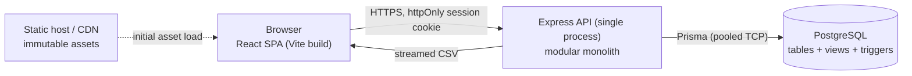

# Architecture — ACME Employee Salary Management

**Status:** Draft v3 for review · 2026-11-22 · Architecture only, no implementation.
**Stack:** React + TypeScript + Vite · Node + Express + TypeScript · PostgreSQL · Prisma ·
Tailwind + shadcn/ui · Zod · Vitest + Supertest.
**Companion documents:** [database-design.md](database-design.md) ·
[api-design.md](api-design.md) · [prisma-schema-draft.prisma](prisma-schema-draft.prisma) ·
[architecture-decisions.md](architecture-decisions.md) · [requirements.md](requirements.md)

---

## 1. System overview

Three deployable units: a static SPA, one Express API process, one PostgreSQL database.
Nothing else — no queue, no cache, no worker, no second service. The requirements
(single HR Manager role, 10,000 employees, low write volume, read-heavy analytics) do not
justify more, and every additional moving part costs correctness and operational surface.



**Trust boundary:** the browser is untrusted. The SPA renders and validates for
convenience; every rule that matters — authentication, authorization, validation,
immutability, decimal scale, currency separation — is enforced in the API and, for the
invariants that must survive a future bug, in the database itself.

---

## 2. Modular monolith — what it means here

One process, one deployable, one database, **module boundaries enforced in code rather
than over the network**. Each module owns its routes, business rules, and data access, and
is only reachable through its public service interface.

```
src/
  modules/
    auth/        sessions, login, password hashing, current user
    employees/   employee CRUD, deactivation, search/filter/sort/pagination
    salaries/    salary events, corrections, history, as-of resolution, currency rules
    analytics/   dashboard KPIs, distribution, department/country comparisons
    audit/       audit log writes (internal) and queries (HR-facing)
    export/      streamed CSV generation
  shared/
    db/          Prisma client, transaction helper, raw-SQL analytics queries
    money/       Decimal + currency value object, scale validation, string serialization
    http/        router factory, validation middleware, error middleware, envelope
    errors/      AppError hierarchy and HTTP mapping
    config/      typed, Zod-validated environment configuration
```

Each module is internally layered, and the layers may only call downward:

| Layer | Responsibility | May not |
|---|---|---|
| `routes` | path, method, Zod schema binding, auth requirement | contain business rules |
| `controller` | HTTP ↔ DTO mapping, status codes, response envelope | touch Prisma |
| `service` | business rules, invariants, transaction boundaries, audit emission | know about HTTP |
| `repository` | Prisma/SQL queries for **its own module's tables only** | call another module |

**Boundary rules (the part that keeps a monolith from rotting):**

1. A module imports another module only through `modules/<name>/index.ts`, which exports
   service interfaces and DTO types — never a repository, never a Prisma model type.
2. Only the owning module writes its tables. `salaries` never writes `employee`; it asks
   `employees` for an employee's status and hire date.
3. `audit` is the one module every write path depends on, by design: an audit write is
   part of the same transaction as the change it records (§5, step 7).
4. Cross-module reads that analytics needs for performance go through SQL **views**, not
   through other modules' repositories — the view is a published contract. This is also how
   any module obtains an employee's **current currency**, which is derived rather than
   stored (ADR-011).
5. Lint-enforced import rules (`eslint-plugin-boundaries` or equivalent) make violations a
   build failure, not a code-review opinion.

**Why this survives growth:** when review cycles and manager proposals arrive (deferred in
requirements §4), they become a new module that consumes `salaries` and `employees` through
their interfaces. If that module ever needs to scale independently, its boundary is already
the only thing that must become a network call. See ADR-002.

---

## 3. Frontend responsibilities

| Concern | Decision |
|---|---|
| Rendering | React 18 + TypeScript, Vite build, SPA served as static assets |
| Routing | React Router; routes: login, employees list, employee detail (+ salary history), dashboard, comparisons, audit log |
| Server state | TanStack Query — all list/filter/sort/pagination state lives in the **URL query string**, which is also the query key, so a filtered view is shareable and reloadable |
| Forms | react-hook-form + the **same Zod schemas** the API uses, shared via a `contracts` package; client validation is UX only (§8) |
| UI | Tailwind + shadcn/ui (DataTable, Dialog, Form, Select, Toast, Card) |
| Money | Never parsed into `number`. Amounts arrive as strings at the currency's own precision, are kept as strings, and are formatted with `Intl.NumberFormat` using that currency |
| Currency | Read from `currentSalary.currency`, never from an employee field — there is none (ADR-011). The UI must handle `currentSalary: null` and a history spanning multiple currencies |
| Charts | Per-currency only. A chart component requires a `currency` prop; there is no component that accepts mixed-currency series (requirements D-6) |
| Entry-time warnings | Duplicate effective date, currency changed by a correction, and backdated-before-latest are surfaced as non-blocking warnings so deterministic rules are visible (database-design.md §6.3) |
| Auth state | Derived from `GET /api/auth/me`; a 401 from any request clears cache and redirects to login |
| What it must never do | Compute payroll totals, averages, medians or buckets; sum amounts; compare amounts across currencies; decide visibility; trust its own validation |

The frontend is a presentation of server-computed answers. Every number on the dashboard
arrives pre-aggregated from SQL (ADR-006), so the browser never holds 10,000 rows.

---

## 4. Backend responsibilities

| Concern | Decision |
|---|---|
| Transport | Express 4 + TypeScript, JSON, cookie-based sessions |
| Validation | Zod schema per endpoint for `params`, `query`, and `body`; unknown keys stripped (no mass assignment). Monetary strings are validated against the currency's `minor_units`, read from the `currency` table |
| Business rules | Services own invariants: append-only writes, correction linkage, prospective-only currency changes, decimal scale, deactivation rules |
| Salary appends | Through `salary_event_append()` via `$queryRaw`, not `prisma.salaryEvent.create()` — the app role has no `INSERT` on `salary_event`. The amount is passed as a **string** so its original precision is validated before `numeric(20,4)` coercion (ADR-020) |
| Transactions | One `prisma.$transaction` per state-changing request; the audit row is written inside it |
| Analytics | Hand-written SQL via `$queryRaw`, results parsed by Zod before leaving the repository (ADR-006) |
| Serialization | Explicit DTO mappers. Prisma objects are never returned to `res.json()`; `Decimal` → string at the currency's precision, `BigInt` → string (api-design.md §1.2) |
| Export | Streamed CSV from a single query; constant memory and one consistent snapshot regardless of row count |
| Authorization | Deny-by-default router: every route under `/api` requires a session unless explicitly listed as public |
| Testing | Vitest for unit (services, money scale, resolution rules) + Supertest against a real PostgreSQL (Testcontainers or a disposable schema) for route/contract tests. The temporal and currency rules in database-design.md §6 are specified as a test table and are the first tests written |

---

## 5. Request lifecycle

```mermaid
sequenceDiagram
  participant U as Browser
  participant M as Middleware chain
  participant C as Controller
  participant S as Service
  participant R as Repository
  participant D as PostgreSQL

  U->>M: POST /api/employees/123/salary-events (cookie)
  M->>M: helmet → cors → cookie-parser → requestId+logger → rate limit
  M->>D: session lookup (token hash → hr_user)
  M->>M: requireSession → requireRole(HR_MANAGER) → CSRF check
  M->>M: Zod parse params/query/body → typed DTO (400 on failure)
  M->>C: validated request
  C->>S: createSalaryEvent(dto, actor)
  S->>D: BEGIN
  S->>R: load employee (status, hire date) + prior currency at effective_date + currency row
  S->>S: assert invariants (scale, prospective currency change, active employee, same employee)
  S->>R: INSERT salary_event
  S->>R: INSERT audit_log
  S->>D: COMMIT
  S-->>C: domain result
  C->>C: map to DTO; Decimal → string at currency precision
  C-->>U: 201 + { data: {...}, meta: { warnings: [...] } }
```

**The ordering is deliberate.** Authentication precedes validation so an unauthenticated
request never reaches a schema or the database. Validation precedes the controller so no
business code handles an unparsed shape. The audit row is written inside the same
transaction as the change, so an audited change cannot be lost and an unaudited change
cannot be committed (ADR-003).

A failure at any step raises a typed `AppError`, skips the remaining steps, and is rendered
by the single error middleware (§7). A database trigger rejection — append-only violation,
decimal scale, backdated currency change — surfaces as a `P0001` exception; for rules the
service also checks, reaching the trigger means the service has a bug, so it is mapped to
`409` and alerted (§7).

---

## 6. Authentication and authorization

**Authentication — opaque server-side sessions, not JWT** (ADR-007).

| Element | Decision |
|---|---|
| Credential | email + password; Argon2id (or bcrypt cost ≥ 12) hashes |
| Session token | 32 random bytes, base64url, sent to the client once; only its SHA-256 hash is stored |
| Cookie | `httpOnly`, `Secure`, `SameSite=Lax`, `Path=/` |
| Lifetime | 8 h idle (sliding), 12 h absolute; both stored on the session row |
| Rotation | A new token is issued on login (prevents session fixation) |
| Revocation | `revoked_at` on the session row; logout and "log out everywhere" are immediate because validity is checked server-side on every request |
| Brute force | Rate limit login to 5 attempts / minute / IP + per-account backoff |
| Audit | Login success **and failure** are audited. A failure on an address that matches no user is recorded with a `null` actor and the attempted address, so unauthenticated attempts are not invisible (database-design.md §3.6) |
| CSRF | `SameSite=Lax` plus a required custom header on all state-changing requests |

**Authorization — one role, enforced explicitly.**

There is exactly one role, `HR_MANAGER`, with organization-wide salary visibility
(requirements §5.1). That makes authorization simple, not absent:

1. Routes are registered through a factory that **requires** an explicit access declaration
   (`public` or `role: HR_MANAGER`). A route with no declaration fails to register — it is
   impossible to ship an accidentally public endpoint.
2. The only public routes are `POST /api/auth/login` and the two `/health` endpoints.
3. Authorization is checked before validation and before any query, in middleware, not in
   controllers.
4. Audit log reads are HR-visible; audit log writes have no API surface at all.

*Changed in v2:* the speculative `AccessScope` parameter threaded through list and analytics
repositories has been removed. One role means one visibility rule, and the abstraction was
anticipating a requirement that does not exist. If department-scoped visibility is ever
introduced, it will be added then, against the real requirement.

---

## 7. Error handling strategy

**One error type hierarchy, one translation layer, one response shape.**

```
AppError (code, httpStatus, message, details?, cause?)
├── ValidationError      400  VALIDATION_FAILED | INVALID_DECIMAL_SCALE
│                             | INVALID_DECIMAL_FORMAT | AMOUNT_OUT_OF_RANGE
│                             | CURRENCY_REQUIRED_FOR_SORT
├── UnauthenticatedError 401  AUTH_REQUIRED | INVALID_CREDENTIALS
├── ForbiddenError       403  FORBIDDEN
├── NotFoundError        404  NOT_FOUND
├── ConflictError        409  STALE_VERSION | EVENT_ALREADY_SUPERSEDED | IMMUTABLE_RECORD
├── UnprocessableError   422  EMPLOYEE_INACTIVE | BACKDATED_CURRENCY_CHANGE
│                             | CURRENCY_CHANGE_REASON_REQUIRED | CURRENCY_INACTIVE
│                             | RULE_VIOLATION
├── RateLimitError       429  RATE_LIMITED
└── InternalError        500  INTERNAL   (message replaced before sending)
```

Uniform error body, same shape for every failure:

```json
{
  "error": {
    "code": "INVALID_DECIMAL_SCALE",
    "message": "Request validation failed",
    "details": [{ "path": "amount", "message": "JPY permits 0 decimal places; received 9000000.50" }],
    "requestId": "01JD3K8QW2ZC4T0M"
  }
}
```

**Translation rules (all in one middleware):**

| Source | Mapped to |
|---|---|
| `ZodError` | 400 `VALIDATION_FAILED` with per-field `details` |
| Scale check against `currency.minor_units` | 400 `INVALID_DECIMAL_SCALE` |
| `P0001` raised by `salary_event_append()` | the code named in the exception's `HINT` — `INVALID_DECIMAL_FORMAT`, `INVALID_DECIMAL_SCALE`, `AMOUNT_OUT_OF_RANGE`, `CURRENCY_INACTIVE` — so one mapping table covers both the service and the database path |
| Prisma `P2002` (unique) | 409 — `supersedes_event_id` collision becomes `EVENT_ALREADY_SUPERSEDED` |
| Prisma `P2003` (FK) | 422 `RULE_VIOLATION` (unknown department, currency, employee) |
| Prisma `P2025` (not found) | 404 `NOT_FOUND` |
| PostgreSQL `P0001` from an immutability trigger | 409 `IMMUTABLE_RECORD`, logged at **error** severity with an alert — reaching it means a code path tried to mutate history |
| PostgreSQL `P0001` from an insert-validation trigger | the matching 400/422 code; also logged at error severity, because the service layer should have caught it first |
| Anything else | 500 `INTERNAL`, generic message, full detail only in the server log |

**Principles.** Errors are values thrown by services and rendered once at the edge;
controllers contain no `try/catch`. No stack trace, SQL fragment, or Prisma message ever
reaches the client. Every response carries the `requestId` also present in the server log.
`409` versus `422` is meaningful: `409` means a state conflict the user can resolve by
reloading, `422` means the request is coherent but violates a domain rule.

---

## 8. Security considerations

| Risk | Control |
|---|---|
| Session theft via XSS | `httpOnly` cookie (token unreachable from JS), strict CSP via helmet, React's default escaping, no `dangerouslySetInnerHTML` |
| CSRF | `SameSite=Lax` + required custom header on mutations (§6) |
| Credential stuffing | Argon2id, login rate limiting, per-account backoff, audited failures (including unknown addresses), no user-enumerating error messages |
| Injection | Prisma parameterization; the few `$queryRaw` analytics queries use bound parameters and an **allow-list** for any sort/group identifier — never string interpolation |
| Mass assignment | Zod schemas with `.strict()`; DTOs list writable fields explicitly; `id`, `recorded_at`, `recorded_by`, `version` are never client-settable |
| Privilege escalation | Deny-by-default route registry (§6); role checked in middleware |
| **CSV injection** | Any exported cell beginning `=`, `+`, `-`, `@`, tab or CR is prefixed with `'`; fields are quoted and internal quotes doubled. An HR export opened in Excel must not execute a formula an employee typed into a note field |
| Bulk salary exfiltration | Every export is audited in `export_log` (actor, filters, row count, timestamp) and rate-limited; exports are the realistic insider-threat path in a compensation system |
| Tampering with history | Three independent layers: withheld privileges, triggers, service rules (database-design.md §8) |
| Sensitive data in logs | Structured logging with a redaction allow-list: amounts, currency-amount pairs, password fields, session tokens and cookies are never logged (requirements NFR-6). The `audit_log` **table** does hold before/after amounts by design — a controlled, access-checked store, not a log file |
| Data at rest | Disk/volume encryption at the database level; a dedicated low-privilege application role (below) |
| Supply chain | Pinned lockfile, `npm audit` / Dependabot in CI, no runtime code generation |
| Secrets | Zod-validated env config, fail-fast on boot if absent; never committed |
| Transport | HTTPS only, HSTS, secure cookies; API and SPA same registrable domain to keep cookies first-party |

**Least-privilege database role.** The application connects as a role that holds:

- `SELECT` on `salary_event`, `audit_log` and `export_log`, and `INSERT` on the latter two
  only — **no `INSERT` on `salary_event`**, which is appended solely through
  `EXECUTE` on `salary_event_append(bigint, text, text, date, text, text, bigint, text, bigint)`
  (ADR-020), and **no `UPDATE` or `DELETE` on any of the three**;
- `SELECT, INSERT, UPDATE` on `employee`, `hr_user`, `hr_session`, `department`;
- `SELECT` on `currency` and the two views;
- **no `DELETE` privilege on any table in the schema**, which is what makes "employees are
  never physically deleted" (ADR-019) a database guarantee rather than an API convention;
- `USAGE` but **not `CREATE`** on schema `public`, so it cannot introduce a definer function
  of its own; and `ALTER DEFAULT PRIVILEGES … REVOKE EXECUTE ON FUNCTIONS FROM PUBLIC`, so a
  future function is not world-executable by default.

Every function grant names its exact signature. An unqualified `GRANT EXECUTE ON FUNCTION
name` would silently extend to any later overload, which in the case of the append function
would mean extending it to a variant that skips a validation.

Prisma Migrate runs as a separate owner role in CI. Even a successful SQL injection through
the analytics path cannot rewrite salary history, erase an audit entry, or delete an
employee.

---

## 9. Configuration, deployment, observability

- **Config:** one Zod-parsed module; the process refuses to start with a missing or
  malformed variable. No `process.env` access outside it.
- **Deploy:** SPA to static hosting; API as a single container; PostgreSQL managed, with
  automated backups and a documented restore drill. Migrations run as a release step
  before the new API image serves traffic.
- **Health:** `GET /health` (liveness) and `GET /health/ready` (DB round-trip).
- **Observability:** structured JSON logs with `requestId`, method, path, status, duration;
  slow-query logging above 200 ms; error aggregation. No metrics backend in MVP.
- **Seeding:** the deterministic 10,000-employee seed (requirements FR-13) is a first-class
  script with a fixed PRNG seed, spanning currencies with 0, 2 and 3 minor units and
  including correction chains, duplicate effective dates and future-dated events. It is
  used by both the demo environment and the performance verification in
  database-design.md §11.

---

## 10. Decisions and open items

### 10.1 Confirmed in v2 (previously open)

| Topic | Decision | Recorded in |
|---|---|---|
| Monetary type | `NUMERIC(20,4)`; permitted decimals per currency via `currency.minor_units` (0, 2, 3), validated by trigger and by Zod; display at the currency's precision | ADR-004, database-design.md §3.5 |
| Average precision | Computed as exact `sum / count`, rounded explicitly to `minor_units + 2`; no cast to a money scale | ADR-004, database-design.md §10 |
| Currency ownership | On `salary_event`, not `employee`; current currency derived; prospective changes only; corrections may fix a mis-entered currency with a mandatory reason | ADR-011 |
| Date boundary | **UTC**, system-wide, defined once in SQL and labelled in the UI | ADR-012 |
| Duplicate effective dates | Permitted, deterministic tiebreak, UI warning at entry | ADR-013 |
| Substring search | `pg_trgm` GIN index on a generated `search_text` column | ADR-014 |
| Events for inactive employees | Rejected in MVP with `422 EMPLOYEE_INACTIVE` | ADR-015 |
| Median | `percentile_disc(0.5)` — exact `numeric`, a real employee's salary | ADR-016 |
| Employees without salary events | Count toward headcount only; never payroll, average, median or buckets; reported separately, split into "never recorded" and "scheduled only" | ADR-017 |
| `knownAt` | Internal to the resolution function; not a public API parameter | ADR-018 |
| Employee deletion | No endpoint, no service method, no `DELETE` grant; deactivate/reactivate only | ADR-019 |
| Pagination | Offset, on every collection including salary history and upcoming events; its snapshot limitations documented honestly rather than overstated | ADR-005, api-design.md §1.3 |
| Audit actor | Nullable, scoped by `CHECK` to `LOGIN_FAILURE` only; attempted address recorded | database-design.md §3.6 |
| `export_log` immutability | Its own trigger, alongside `salary_event` and `audit_log` | database-design.md §8 |
| Speculative `AccessScope` | Removed (§6) | — |
| Salary append path | `salary_event_append()` taking the amount as `text`, `SECURITY DEFINER`, `SET search_path = pg_catalog, pg_temp`, fully schema-qualified; `acme_app` holds `EXECUTE` and no `INSERT` | ADR-020 |
| Original decimal precision | Validated **pre-coercion** with `min_scale()` in the database; strict `scale()` in Zod | ADR-004, ADR-020 |
| Concurrent appends | Serialized per employee by `SELECT … FOR UPDATE` on the `employee` row inside the append function; also closes the append-vs-deactivate race | ADR-021 |
| `TRUNCATE` | `BEFORE TRUNCATE … FOR EACH STATEMENT` triggers on all three append-only tables | database-design.md §8 |
| Export audit | Two append-only rows, `STARTED` then `COMPLETED`, paired by `request_id`; an aborted export leaves its `STARTED` row | ADR-022 |
| Prisma `views` preview | Dropped; both views read via `$queryRaw` + Zod | ADR-008 |
| Average precision | API returns `minor_units + 2`; **the UI owns final display rounding** | ADR-004, api-design.md §1.2 |
| PostgreSQL version | Exact patch pinned in one file, asserted in CI, matched by production | database-implementation-plan.md §1.1 |
| NFR-6 vs FR-11 | Distinction confirmed: NFR-6 governs application log files; `audit_log` is an access-controlled table | §8 |

### 10.2 Still open — your decision

| # | Issue | Recommendation |
|---|---|---|
| 1 | **`CURRENCY_CHANGE` as a required reason.** I made it mandatory for a non-correcting currency change, which makes currency switches filterable in history but blocks "promotion + relocation in one event". | *Keep it mandatory; a promotion that also changes currency is two events, which is also the more honest history.* |
| 2 | **Currency-filter performance.** With currency derived, filtering or sorting by it resolves current salary for the whole population first (database-design.md §11). | *Verify with `EXPLAIN ANALYZE` against the 10,000-employee seed before implementation is called done. If it misses NFR-1, use the ADR-006 materialized view — not a denormalized currency column.* |
| 3 | **`pg_trgm` availability.** Needs `CREATE EXTENSION` on the chosen host **and in the Prisma shadow database**, since `citext` is a column type (prisma-schema-draft.prisma header). | *Confirm with the hosting provider — it blocks M0. Fallback is a `tsvector` column with GIN, which handles prefix but not mid-word substrings.* |
| 8 | **PostgreSQL patch version.** The exact `16.x` to pin in CI, and the version production reports. | *Supply both; CI asserts `server_version` against a single pinned value and a mismatch is a release blocker (database-implementation-plan.md §1.1).* |
| 9 | **`export_log` column shape** for ADR-022: `status` + nullable `row_count` + `request_id`. | *Confirm the shape; the behaviour is already approved, but this changes the Prisma model and the ER diagram.* |
| 4 | **Correction that changes currency on a non-latest event.** Permitted today, and it can make an employee's historical currency sequence non-monotonic. | *Permit, with the UI warning already specified. Forbidding it would leave genuinely mis-entered history unfixable.* |
| 5 | **`Idempotency-Key` on mutations.** | *P1. The append-only model makes a duplicate submission visible and correctable rather than destructive.* |
| 6 | **Audit and export log retention.** Both tables grow without bound and neither can be deleted by the application role. | *Decide a retention period with whoever owns compliance; implement as a privileged archival job, not an application feature. Out of MVP scope but needs an owner.* |
| 7 | **Session pruning.** Expired `hr_session` rows accumulate. | *A `DELETE` by the migration/owner role on a schedule — the app role has no `DELETE`. Trivial, but it is an operational task someone must own.* |

### 10.3 Phase 3 working rules adopted with ADR-020/021

| Rule | Why it exists |
|---|---|
| **One salary append per transaction** | ADR-021's row lock makes multi-employee batches a deadlock risk unless they lock in ascending `employee_id` order |
| Salary appends use `$queryRaw` on `salary_event_append()` | The app role has no `INSERT` on `salary_event` |
| Dates cross module boundaries as `'YYYY-MM-DD'` strings | Never `new Date(y, m, d)` or local getters on a `@db.Date` value, which shift the day at negative UTC offsets |
| `CURRENT_DATE` and friends are banned in SQL | CI greps for them; `public.utc_today()` is the single definition site |

---

**Awaiting review before any implementation begins.** Phase 3 scope and sequencing live in
[database-implementation-plan.md](database-implementation-plan.md); its test specification is
[sql-test-matrix.md](sql-test-matrix.md).
