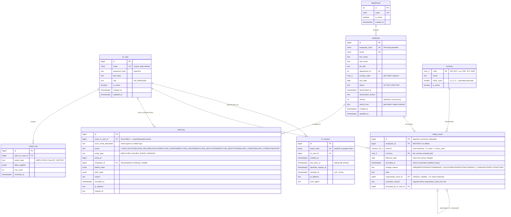
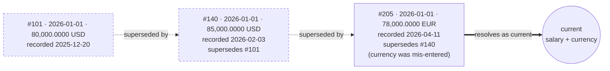

# Database Design — ACME Employee Salary Management

**Status:** Draft v2 for review · 2026-11-22 · Design only; no migrations generated.
**Engine:** PostgreSQL 16 · **Access:** Prisma ORM + hand-written SQL for views, triggers
and analytics. Companion: [architecture.md](architecture.md) ·
[prisma-schema-draft.prisma](prisma-schema-draft.prisma) · [api-design.md](api-design.md)

---

## 1. Design summary

Nine tables and two views. The model is deliberately boring except in one place: salary is
not a column, it is an **append-only, bi-temporal event log**, and every "current salary"
and **current currency** in the product is derived from it at read time.

| Object | Kind | Mutability |
|---|---|---|
| `hr_user` | table | mutable |
| `hr_session` | table | mutable (`last_seen_at`, `revoked_at`) |
| `department` | table | mutable |
| `currency` | reference table | effectively static |
| `employee` | table | mutable status/attributes; **never deleted** |
| `salary_event` | table | **append-only — no UPDATE, no DELETE, ever** |
| `audit_log` | table | **append-only** |
| `export_log` | table | **append-only** |
| `employee_current_salary` | view | derived (amount **and** currency) |
| `salary_event_resolved` | view | derived (adds `is_superseded`, `superseded_by_id`) |

**Two structural rules worth stating before the diagram:**

1. **Money is `NUMERIC(20,4)`** everywhere, with the *permitted* number of decimals for a
   given amount determined by its currency's `minor_units` (0, 2 or 3) and enforced by
   trigger. Storage scale is uniform; semantic scale is per currency.
2. **Currency belongs to the salary event, not the employee.** An employee has no currency
   column. Their current currency is whatever their currently-resolved event says, their
   historical events keep the currency they were paid in, and a currency change is a new
   event (§4.4).

---

## 2. ER diagram



---

## 3. Tables, types and constraints

### 3.1 Type choices

| Need | Type | Why |
|---|---|---|
| Money | **`NUMERIC(20,4)`** | Exact base-10 with headroom for every ISO-4217 scale in use: 0 decimals (JPY, KRW), 2 (USD, EUR), 3 (KWD, BHD, OMR, TND). Scale 4 leaves one spare digit so no currency's own precision is ever the binding limit, and 16 integer digits hold any annual salary including 0-decimal currencies. How many decimals a *given* amount may carry comes from `currency.minor_units`, enforced by trigger (§3.5) |
| Permitted decimals | `currency.minor_units SMALLINT` | 0, 2 or 3 today; a new currency is a reference-data row, not a migration |
| Surrogate keys | `BIGSERIAL` (identity) | Monotonic insertion order gives D-1 its final deterministic tiebreaker; a random UUID cannot order events. Employee-facing identity is `employee_code`, so sequential ids leak nothing meaningful |
| "When the money changes" | `DATE` | Payroll effectivity is a calendar date, not an instant. The one remaining question — which date is "today" — is settled as **UTC** (§5.4) |
| "When we learned it" | `TIMESTAMPTZ` | A real instant, always stored UTC |
| Enum-ish columns | `TEXT` + `CHECK` | Values will change (new change reasons, new audit actions). PostgreSQL enums need `ALTER TYPE` migrations and Prisma couples tightly to them; a `CHECK` list is a one-line migration, and Zod still gives TypeScript a closed union |
| Email / codes | `CITEXT` | Case-insensitive uniqueness without `LOWER()` indexes everywhere |
| Country | `CHAR(2)` + `CHECK` on shape | No country lookup table — requirements make no assumption about which or how many countries exist |
| Audit payloads | `JSONB` | Shape differs per entity; queried by containment occasionally, never joined |

### 3.2 Keys and unique constraints

| Table | Primary key | Unique | Notes |
|---|---|---|---|
| `hr_user` | `id` | `email` | |
| `hr_session` | `id` | `token_hash` | raw token never stored |
| `department` | `id` | `name` | |
| `currency` | `code` | — | natural key |
| `employee` | `id` | `employee_code`, `email` | no currency column by design (§4.4) |
| `salary_event` | `id` | **`supersedes_event_id`** | the load-bearing constraint — §4.2 |
| `audit_log` | `id` | — | append-only, no natural key |
| `export_log` | `id` | — | |

### 3.3 Foreign keys

| From | To | Nullable | On delete | Why |
|---|---|---|---|---|
| `salary_event.employee_id` | `employee.id` | no | **RESTRICT** | Database-level guarantee that an employee with salary history cannot be physically deleted |
| `salary_event.supersedes_event_id` | `salary_event.id` | yes | RESTRICT | Self-referencing correction chain |
| `salary_event.currency` | `currency.code` | no | RESTRICT | |
| `salary_event.recorded_by_hr_user_id` | `hr_user.id` | no | RESTRICT | Attribution must survive HR staff turnover |
| `employee.department_id` | `department.id` | no | RESTRICT | Departments are deactivated, not deleted |
| `audit_log.actor_hr_user_id` | `hr_user.id` | **yes** | RESTRICT | Nullable so unauthenticated events are auditable (§3.6) |
| `audit_log.employee_id` | `employee.id` | yes | RESTRICT | Audit must never be orphaned or cascade-deleted |
| `export_log.actor_hr_user_id` | `hr_user.id` | no | RESTRICT | An export always has an authenticated actor |
| `hr_session.hr_user_id` | `hr_user.id` | no | CASCADE | Sessions are disposable; the only cascade in the schema |

### 3.4 Row-level CHECK constraints

```sql
-- salary_event
CHECK (amount > 0)
CHECK (currency = upper(currency))
CHECK (supersedes_event_id IS NULL OR supersedes_event_id < id)   -- cycles impossible
CHECK (supersedes_event_id IS NULL OR correction_reason IS NOT NULL)
CHECK (supersedes_event_id IS NOT NULL OR change_reason <> 'CORRECTION')
CHECK (change_reason IN ('HIRE','MERIT','PROMOTION','MARKET_ADJUSTMENT',
                         'DEMOTION','CURRENCY_CHANGE','CORRECTION','OTHER'))

-- currency
CHECK (minor_units IN (0, 2, 3))

-- employee
CHECK (status IN ('ACTIVE','INACTIVE'))
CHECK ((status = 'INACTIVE') = (deactivated_at IS NOT NULL))
CHECK (country_code ~ '^[A-Z]{2}$')

-- audit_log: an actor is required for everything except unauthenticated events
CHECK (actor_hr_user_id IS NOT NULL OR action IN ('LOGIN_FAILURE'))
CHECK (action <> 'LOGIN_FAILURE' OR actor_email_attempted IS NOT NULL)
```

`supersedes_event_id < id` is worth pausing on: because ids are monotonic and a correction
may only point at a **lower** id, a correction chain can only ever point backwards in
insertion order. Cycles are therefore impossible at the storage level — no recursive check
and no trigger needed.

### 3.5 Decimal scale validation (new)

`NUMERIC(20,4)` coerces every stored value to scale 4, so `scale(amount)` cannot be used to
detect over-precision after the fact — `100.00` becomes `100.0000`. The check is therefore
value-based, in the `BEFORE INSERT` trigger (§8):

```sql
IF NEW.amount <> round(NEW.amount, c.minor_units) THEN
  RAISE EXCEPTION 'amount % has more than % decimal places for currency %',
    NEW.amount, c.minor_units, NEW.currency USING ERRCODE = 'P0001';
END IF;
```

So `12345.678 KWD` is accepted (3 minor units), `9000000.5 JPY` is rejected (0), and
`85000.001 USD` is rejected (2). The same rule is applied by Zod at the API boundary, from
the same `currency` table, so the user gets a `400` with a field-level message instead of a
trigger error. Because stored amounts can never carry more decimals than their currency
permits, serializing to `minor_units` for display is **lossless** (§10, api-design.md §1.2).

### 3.6 Auditing unauthenticated events (new)

A failed login for an address that does not exist in `hr_user` must still be auditable —
that is exactly the event a security review cares about. `audit_log.actor_hr_user_id` is
therefore nullable, and `actor_email_attempted` records the address that was typed:

| Event | `actor_hr_user_id` | `actor_email_attempted` |
|---|---|---|
| Successful login | the user's id | the address used |
| Failed login, known email | the matching user's id | the address used |
| Failed login, **unknown email** | `NULL` | the address typed |
| Any authenticated action | the acting user's id | `NULL` |

The `CHECK` constraints in §3.4 make the nullable actor available **only** to
`LOGIN_FAILURE`, so the relaxation cannot leak into salary or employee auditing. The typed
address is stored; the submitted password never is, in any form.

---

## 4. Salary history, currency, and correction handling

### 4.1 The two time axes

| Column | Meaning | Changes an as-of answer? |
|---|---|---|
| `effective_date` (DATE) | the date from which the employee is paid this amount | yes — it *is* the salary timeline |
| `recorded_at` (TIMESTAMPTZ) | the instant HR entered it into the system | no — it records *when we knew* |

A **backdated** event has `effective_date < recorded_at::date`: HR learned late about a
raise that began earlier. A **future-dated** event has `effective_date > today` (UTC): an
approved raise not yet in force. Both are ordinary rows.

### 4.2 Corrections: a new event, never a mutation

A correction inserts a **new** event whose `supersedes_event_id` points at the event being
corrected, carrying a mandatory `correction_reason`. The original row is untouched — it
keeps its amount, its currency, its `recorded_at`, and its author forever.



**Supersession is derived, not stored.** There is no `is_superseded` column, because
setting one would require an `UPDATE` on an append-only table. An event is superseded
exactly when another event points at it:

```sql
CREATE VIEW salary_event_resolved AS
SELECT e.*,
       s.id          AS superseded_by_id,
       s.recorded_at AS superseded_at,
       (s.id IS NOT NULL) AS is_superseded
FROM   salary_event e
LEFT   JOIN salary_event s ON s.supersedes_event_id = e.id;   -- 1:1 via UNIQUE
```

`UNIQUE (supersedes_event_id)` does three jobs at once:

1. makes that `LEFT JOIN` provably 1:1, so the view is cheap and unambiguous;
2. forbids **forked chains** — two different corrections of the same event cannot exist, so
   "the latest version of this event" is always a single row;
3. gives concurrent-correction safety for free: if two HR Managers correct event #101 at the
   same moment, the second `INSERT` fails on the unique index and the API returns
   `409 EVENT_ALREADY_SUPERSEDED` rather than silently creating two competing truths.

Chains of arbitrary depth (correct a correction) work naturally: only the tail of a chain
has no successor, so only the tail can resolve as current. Superseded events never
participate in any current-salary or analytics calculation — the resolution queries in §5
exclude them with `NOT EXISTS`.

### 4.3 What a correction may and may not change

A correction may restate the **amount**, the **effective date**, the **currency**, the
reason, or the note — all three of the first are real data-entry mistakes HR makes. Its
`correction_reason` is mandatory, so a currency correction always carries its justification.
A correction may **not** change the employee (trigger-enforced), may not target an
already-superseded event (unique index), and may not target itself (`CHECK`).

Because a correction may change currency, an employee's history can legitimately contain
more than one currency, and correcting an old event's currency can make the historical
currency sequence non-monotonic. That is accepted: corrections are rare, always reasoned,
and always visible in history. The UI warns when a correction changes currency, the same way
it warns on a duplicate effective date (§6.3).

### 4.4 Currency belongs to the event (changed in v2)

`employee.salary_currency` has been **removed**. There is no employee-level currency column
at all, and therefore no possibility of it disagreeing with the events it was meant to
summarize.

| Question | Answer |
|---|---|
| What currency is this employee paid in **now**? | `employee_current_salary.currency` — derived (§5.3) |
| What were they paid in **in 2023**? | the currency on the event that resolves for that date; historical events are immutable, so this never changes |
| How does a currency change happen? | a **new** salary event with the new currency, `change_reason = 'CURRENCY_CHANGE'`, and an `effective_date` **on or after today (UTC)** |
| Can a currency change be backdated? | **No.** Rejected with `422 BACKDATED_CURRENCY_CHANGE`. Money that was actually paid in one currency cannot retroactively become another currency; if the original entry was simply wrong, that is a *correction* (§4.3), not a change |
| What if the employee had no event yet? | the first event sets the currency freely — there is no prior currency to change |

The trigger rule, stated precisely:

> For a **non-correcting** event *E*, let `prior` be the currency of the live event with the
> greatest `effective_date ≤ E.effective_date` for that employee (excluding *E*). If
> `prior` exists and `E.currency <> prior`, then *E* must have
> `effective_date >= CURRENT_DATE` (UTC) and `change_reason = 'CURRENCY_CHANGE'`.

Comparing against the currency **at that point in the timeline** rather than against today's
currency is what makes the rule behave correctly in the awkward cases: a backdated USD raise
effective before an already-scheduled switch to EUR is fine, because USD was the currency
then.

**What this costs.** Filtering or sorting employees by currency is no longer an indexed
column on `employee`; it requires resolving current salary first (§7, §11). At 10,000
employees this stays inside NFR-1, but it is a real trade-off and is recorded as ADR-011.

---

## 5. Resolving salary for any date

### 5.1 The rule (requirements D-1, generalized to both time axes)

> An employee's salary **as of calendar date `D`**, **as known at instant `T`**, is the
> event with the greatest `effective_date ≤ D` among events where `recorded_at ≤ T` and
> which have no superseding event recorded at or before `T`; ties on `effective_date` are
> broken by the later `recorded_at`, then by the higher `id`. The resolved event supplies
> both the **amount and the currency**.

`T` defaults to `now()`, which collapses the rule to the everyday reading: "our current
best knowledge of what this employee was paid on date `D`".

### 5.2 One function serves every salary read

```sql
CREATE FUNCTION salary_as_of(
  p_employee_id bigint,
  p_as_of       date        DEFAULT (now() AT TIME ZONE 'UTC')::date,
  p_known_at    timestamptz DEFAULT now()
) RETURNS TABLE (salary_event_id bigint, amount numeric(20,4), currency char(3),
                 effective_date date, recorded_at timestamptz, change_reason text)
LANGUAGE sql STABLE AS $$
  SELECT e.id, e.amount, e.currency, e.effective_date, e.recorded_at, e.change_reason
  FROM   salary_event e
  WHERE  e.employee_id = p_employee_id
    AND  e.effective_date <= p_as_of
    AND  e.recorded_at    <= p_known_at
    AND  NOT EXISTS (
           SELECT 1 FROM salary_event s
           WHERE  s.supersedes_event_id = e.id
             AND  s.recorded_at <= p_known_at)
  ORDER  BY e.effective_date DESC, e.recorded_at DESC, e.id DESC
  LIMIT  1;
$$;
```

`p_known_at` is a parameter rather than a hard-coded `now()`, so the same function answers
both "what is she paid today" and the audit question "what did this system report on
3 February" — recoverable only because nothing is ever overwritten. **`knownAt` stays
internal**: it is used by tests and by support investigations, and is not a client-settable
API parameter (api-design.md §4.4).

### 5.3 The current-salary view (the hot path)

```sql
CREATE VIEW employee_current_salary AS
SELECT DISTINCT ON (e.employee_id)
       e.employee_id, e.id AS salary_event_id,
       e.amount, e.currency, e.effective_date, e.recorded_at, e.change_reason
FROM   salary_event e
WHERE  e.effective_date <= (now() AT TIME ZONE 'UTC')::date
  AND  NOT EXISTS (SELECT 1 FROM salary_event s WHERE s.supersedes_event_id = e.id)
ORDER  BY e.employee_id, e.effective_date DESC, e.recorded_at DESC, e.id DESC;
```

`DISTINCT ON` with an `ORDER BY` that matches the composite index (§7) lets PostgreSQL walk
one index and emit one row per employee, carrying amount **and** currency. At the seeded
scale — 10,000 employees, roughly 50,000–80,000 events — this is a single index scan in low
tens of milliseconds, comfortably inside NFR-1.

**Why a plain view and not a materialized view or a `current_salary` column:** correctness
across the date boundary. A future-dated event must become current the moment the calendar
rolls over, with no job running. Any stored projection is wrong from midnight until it is
refreshed, and "the dashboard was stale for six hours" is exactly the class of bug that
destroys trust in a payroll source of truth. A `MATERIALIZED VIEW` with a nightly plus
on-write `REFRESH` remains the documented scale lever (ADR-006); it is not needed at 10k.

### 5.4 "Today" is UTC, system-wide (finalized)

Every date boundary in the system — the view above, `salary_as_of`'s default, the
prospective-currency-change rule, dashboard `asOf`, "upcoming" events — uses
`(now() AT TIME ZONE 'UTC')::date`. There is exactly one definition of today, it is written
once in SQL, and the UI labels every derived figure with it (`as of 2026-11-22 UTC`).

A per-user timezone would mean two HR Managers in different offices disagree about an
employee's current salary for up to a day at every change boundary, and an export taken in
Dubai would not reconcile with one taken in New York. Confirmed as ADR-012.

---

## 6. Worked resolution examples (and the first tests to write)

Employee #42, all events, `now = 2026-11-22 UTC`:

| id | effective_date | amount | currency | recorded_at | supersedes | state |
|---|---|---|---|---|---|---|
| 101 | 2026-01-01 | 80,000.0000 | USD | 2025-12-20 | — | superseded by 140 |
| 140 | 2026-01-01 | 85,000.0000 | USD | 2026-02-03 | 101 | superseded by 205 |
| 205 | 2026-01-01 | 86,000.0000 | USD | 2026-04-11 | 140 | live |
| 212 | 2026-07-01 | 86,000.0000 | USD | 2026-05-02 | — | live (promotion, same amount) |
| 230 | 2026-07-01 | 90,000.0000 | USD | 2026-06-15 | — | live — **duplicate effective date** |
| 318 | 2027-01-01 | 78,000.0000 | EUR | 2026-11-01 | — | live, **future-dated currency change** |

| Query | Resolves to | Rule exercised |
|---|---|---|
| current (`asOf = 2026-11-22`) | **#230, 90,000.00 USD** | future event #318 excluded; duplicate date broken by later `recorded_at` |
| `asOf = 2026-03-15` | **#205, 86,000.00 USD** | correction chain tail wins; #101 and #140 excluded as superseded |
| `asOf = 2026-03-15, knownAt = 2026-03-01` | **#140, 85,000.00 USD** | #205 not yet recorded, so #140 was then the live tail |
| `asOf = 2026-03-15, knownAt = 2026-01-15` | **#101, 80,000.00 USD** | what the system reported in January |
| `asOf = 2025-06-01` | **no row** | before any effective event; API returns `null`, never 0 |
| `asOf = 2027-03-01` | **#318, 78,000.00 EUR** | future-dated events resolve for future as-of dates — **and carry the new currency** |

### 6.1 Additional cases the test table must cover

| Case | Expected |
|---|---|
| Two events, identical `effective_date` **and** `recorded_at` | higher `id` wins (final tiebreaker) |
| Backdated event in the **same** currency as the prior event | accepted |
| Backdated event in a **different** currency from the prior event | rejected, `422 BACKDATED_CURRENCY_CHANGE` |
| Prospective event in a different currency, `change_reason = 'CURRENCY_CHANGE'` | accepted |
| Prospective event in a different currency, `change_reason = 'MERIT'` | rejected, `422 CURRENCY_CHANGE_REASON_REQUIRED` |
| Correction that changes currency, with `correction_reason` | accepted; original keeps its currency |
| `9000000.50 JPY` (0 minor units) | rejected, scale violation |
| `12345.678 KWD` (3 minor units) | accepted |
| Event for an `INACTIVE` employee | rejected, `422 EMPLOYEE_INACTIVE` |
| Correction of an already-superseded event | rejected, `409 EVENT_ALREADY_SUPERSEDED` |

### 6.2 Duplicate effective dates (confirmed behaviour)

Permitted. Two events on one date resolve deterministically by later `recorded_at`, then
higher `id`; the loser remains in history and is shown as `HISTORICAL`, never as current.
Rejecting duplicates would block legitimate same-day corrections and re-entries. The UI
warns at entry time — "this employee already has an event effective 2026-07-01; the later
entry will take precedence" — so a duplicate is always a deliberate act (ADR-013).

### 6.3 UI warnings that are part of the contract

Three entry-time warnings are specified here because they exist to make deterministic rules
*visible*, not to enforce them: duplicate effective date (§6.2), a correction that changes
currency (§4.3), and a backdated event whose effective date precedes the employee's latest
recorded event.

---

## 7. Indexing strategy

| Index | Definition | Serves |
|---|---|---|
| **Salary resolution** | `salary_event (employee_id, effective_date DESC, recorded_at DESC, id DESC)` | `salary_as_of`, the current-salary view, per-employee paginated history — exactly matches the `ORDER BY`, so `DISTINCT ON` needs no sort |
| Supersession probe | `salary_event (supersedes_event_id)` — implicit, from `UNIQUE` | the `NOT EXISTS` / `LEFT JOIN` in every resolution |
| Scheduled changes | `salary_event (effective_date, id)` | paginated "upcoming events" (`effective_date > today`) |
| Recent changes feed | `salary_event (recorded_at DESC)` | dashboard "recent salary changes" |
| Currency grouping | `salary_event (currency)` | assists per-currency analytics grouping after resolution |
| Employee list sorts | `employee (last_name, first_name, id)`, `employee (hire_date, id)` | stable multi-column sort + pagination |
| Employee filters | `employee (status, department_id)`, `employee (status, country_code)` | the common filter combinations; `status` leads because almost every screen filters it |
| Free-text search | GIN trigram on generated `search_text` = `first_name ‖ ' ' ‖ last_name ‖ ' ' ‖ email ‖ ' ' ‖ employee_code` | substring search on name/email/code (ADR-014) |
| Unique business keys | `employee (employee_code)`, `employee (email)`, `hr_user (email)`, `hr_session (token_hash)` | lookups and integrity |
| Audit queries | `audit_log (employee_id, recorded_at DESC)`, `audit_log (actor_hr_user_id, recorded_at DESC)`, `audit_log (action, recorded_at DESC)`, `audit_log (recorded_at DESC)` | the four ways HR filters the log |
| Session validation | `hr_session (token_hash) WHERE revoked_at IS NULL` | every authenticated request |

**Removed in v2:** `employee (status, salary_currency)` — the column is gone (§4.4).
Currency filtering now runs against the resolved current salary, which costs a resolution
scan rather than an index seek; §11 records the measurement obligation.

**Deliberately absent:** no index on `amount`. Analytics scans and aggregates whole
per-currency groups, where a sequential scan over ~10k resolved rows beats an index; adding
one would slow every write for no read benefit. All index choices are to be confirmed with
`EXPLAIN ANALYZE` against the seeded 10,000-employee dataset — that is what the
deterministic seed is for.

---

## 8. Append-only enforcement (defense in depth)

Prisma cannot express immutability, so it is enforced in three independent layers. Any one
of them failing still leaves history intact.

**Layer 1 — privileges.** The application role may only read and append to the three
append-only tables:

```sql
REVOKE ALL ON salary_event, audit_log, export_log FROM acme_app;
GRANT  SELECT, INSERT ON salary_event, audit_log, export_log TO acme_app;
GRANT  USAGE ON SEQUENCE salary_event_id_seq, audit_log_id_seq, export_log_id_seq TO acme_app;
-- Mutable tables keep UPDATE; nothing in the schema grants DELETE to the app role.
GRANT  SELECT, INSERT, UPDATE ON employee, hr_user, hr_session, department TO acme_app;
GRANT  SELECT ON currency, employee_current_salary, salary_event_resolved TO acme_app;
```

Prisma Migrate runs as a separate owner role in CI. Even a successful SQL injection through
the analytics path cannot rewrite or erase salary history, audit entries, or export records.

**Layer 2 — triggers.**

```sql
CREATE FUNCTION reject_mutation() RETURNS trigger LANGUAGE plpgsql AS $$
BEGIN
  RAISE EXCEPTION '% is append-only; % is not permitted (use a correcting event)',
    TG_TABLE_NAME, TG_OP USING ERRCODE = 'P0001';
END $$;

CREATE TRIGGER salary_event_no_mutate BEFORE UPDATE OR DELETE ON salary_event
  FOR EACH ROW EXECUTE FUNCTION reject_mutation();
CREATE TRIGGER audit_log_no_mutate   BEFORE UPDATE OR DELETE ON audit_log
  FOR EACH ROW EXECUTE FUNCTION reject_mutation();
CREATE TRIGGER export_log_no_mutate  BEFORE UPDATE OR DELETE ON export_log
  FOR EACH ROW EXECUTE FUNCTION reject_mutation();   -- added in v2
```

**Layer 2b — `BEFORE INSERT` validation on `salary_event`**, for the cross-row rules a
`CHECK` cannot see. All raise `P0001`:

| # | Rule | Error surfaced as |
|---|---|---|
| 1 | employee exists and `status = 'ACTIVE'` | `422 EMPLOYEE_INACTIVE` |
| 2 | `effective_date >= employee.hire_date` | `422 RULE_VIOLATION` |
| 3 | superseded event belongs to the **same employee** | `422 RULE_VIOLATION` |
| 4 | `amount = round(amount, currency.minor_units)` (§3.5) | `400 INVALID_DECIMAL_SCALE` |
| 5 | `currency.is_active` | `422 CURRENCY_INACTIVE` |
| 6 | non-correcting currency change is prospective and reasoned (§4.4) | `422 BACKDATED_CURRENCY_CHANGE` / `422 CURRENCY_CHANGE_REASON_REQUIRED` |

**Layer 3 — services.** The same rules are asserted in the `salaries` service so the user
gets a precise 4xx instead of a trigger error. Reaching layer 2 means layer 3 has a bug,
which is why `P0001` is mapped to 409 and logged at error severity (architecture.md §7).

**Verification, not assumption.** Integration tests attempt `UPDATE salary_event`,
`DELETE FROM audit_log`, and `UPDATE export_log` and assert each fails, plus one test per
rule in the tables above. A migration that drops a trigger fails the suite.

**Migration ownership.** Prisma Migrate owns tables, columns, relations and plain indexes.
Views, triggers, functions, `CHECK` constraints, generated columns, extensions and `GRANT`s
live in hand-written SQL appended to the generated migration files (ADR-008).

---

## 9. Deactivated employees — and no deletion at all

Deactivation is a **status transition**. In v2 there is no deletion path of any kind:
`DELETE /api/employees/:id` has been removed from the API (api-design.md §3), no service
method deletes an employee, and the application role holds no `DELETE` privilege (§8).

| Rule | Mechanism |
|---|---|
| No physical deletion, ever | No endpoint, no service method, no `DELETE` grant. `salary_event.employee_id` FK `ON DELETE RESTRICT` remains as a fourth layer for anyone with direct database access |
| Salary history retained and queryable | No cascade, no soft-delete filter on `salary_event`. History and `salary_as_of` behave identically for inactive employees |
| Audit records retained | `audit_log.employee_id` FK `RESTRICT`; table append-only |
| Excluded from active payroll totals | Analytics join `employee` and filter `status = 'ACTIVE'`; the inactive count is reported separately (requirements §5.4) |
| Still findable | `status` is a filter on the employee list, defaulting to `ACTIVE` but switchable to `INACTIVE` or `ALL` |
| No new salary events while inactive | Insert trigger rule 1 + service rule → `422 EMPLOYEE_INACTIVE` (confirmed, ADR-015) |
| Reactivation | Sets `status = 'ACTIVE'`, clears `deactivated_at`, and is itself audited. No history is rewritten |
| A mistyped employee created minutes ago | Deactivated with a reason such as "created in error", not deleted. One extra row is a cheaper price than a deletion path |

---

## 10. Analytics without mixing currencies, and without losing exactness

Every aggregate carries `currency` in its `GROUP BY`. There is no query in the system that
sums or averages across currencies, and no view that could tempt one (requirements D-6).

```sql
-- Dashboard: payroll and average per currency, active employees only
SELECT cs.currency,
       count(*)                                              AS employee_count,
       sum(cs.amount)                                        AS total_payroll,
       round(sum(cs.amount) / count(*), c.minor_units + 2)   AS average_salary
FROM   employee_current_salary cs
JOIN   employee em ON em.id = cs.employee_id
JOIN   currency c  ON c.code = cs.currency
WHERE  em.status = 'ACTIVE'
GROUP  BY cs.currency, c.minor_units
ORDER  BY cs.currency;
```

**On exactness (changed in v2).** `sum` over `NUMERIC(20,4)` is exact, and because every
amount respects its currency's `minor_units` (§3.5), the sum does too — it serializes to
`minor_units` losslessly. An **average** is division, which is not exactly representable in
general (think three salaries summing to 100), so there is no "exact" average to preserve.
Rather than cast it to an arbitrary fixed scale — the `::numeric(14,2)` in v1 silently threw
away precision and implied a money-shaped answer — the average is computed as exact
`sum / count` and rounded **explicitly** to `minor_units + 2`, with the rounding stated in
the response `meta`. It is labelled a derived statistic, not a payroll amount.

```sql
-- Department comparison: average AND median, per currency (requirements FR-10)
SELECT em.department_id, d.name, cs.currency,
       count(*)                                                 AS employee_count,
       round(sum(cs.amount) / count(*), c.minor_units + 2)       AS average_salary,
       percentile_disc(0.5) WITHIN GROUP (ORDER BY cs.amount)    AS median_salary
FROM   employee_current_salary cs
JOIN   employee em  ON em.id   = cs.employee_id
JOIN   department d ON d.id    = em.department_id
JOIN   currency c   ON c.code  = cs.currency
WHERE  em.status = 'ACTIVE'
GROUP  BY em.department_id, d.name, cs.currency, c.minor_units;
```

`percentile_disc(0.5)` is confirmed (ADR-016): `percentile_cont` returns
`double precision`, which would put a floating-point value into a monetary response and
break D-5. `percentile_disc` stays exact `numeric` and returns a real employee's salary
rather than an interpolation — for an even-sized group it returns the lower of the two
middle values, which the API states in `meta.medianMethod`.

```sql
-- Distribution buckets, computed independently per currency (requirements FR-9)
WITH bounds AS (
  SELECT cs.currency, min(cs.amount) AS lo, max(cs.amount) AS hi
  FROM   employee_current_salary cs
  JOIN   employee em ON em.id = cs.employee_id
  WHERE  em.status = 'ACTIVE'
  GROUP  BY cs.currency
)
SELECT b.currency, b.lo, b.hi,
       width_bucket(cs.amount, b.lo, b.hi + 1, 8) AS bucket,
       count(*) AS employee_count
FROM   employee_current_salary cs
JOIN   employee em ON em.id = cs.employee_id
JOIN   bounds b    ON b.currency = cs.currency
WHERE  em.status = 'ACTIVE'
GROUP  BY b.currency, b.lo, b.hi, bucket
ORDER  BY b.currency, bucket;
```

Bucket boundaries come from each currency's own `min`/`max`, so a JPY bucket and a USD
bucket are never the same range and are never rendered on a shared axis. `width_bucket` has
a `numeric` overload, so bucketing is also float-free.

**Employees with no current salary (confirmed, ADR-017).** Every analytics query above
joins `employee_current_salary`, so an employee with no resolvable event contributes to
**headcount only** — never to a total, average, median or bucket. They are counted and
reported separately so the gap is visible rather than silent, split into "never recorded"
and "scheduled only" (api-design.md §5).

---

## 11. Concurrency and the cost of deriving currency

| Scenario | Outcome |
|---|---|
| Two HR Managers add a salary event for the same employee simultaneously | Both succeed — appending is always safe. Both are visible in history; D-1 decides deterministically which is current. No lost update is possible because nothing is updated |
| Two HR Managers correct the **same** event simultaneously | First wins; second fails on `UNIQUE (supersedes_event_id)` → `409 EVENT_ALREADY_SUPERSEDED`. No forked chain can exist |
| Two concurrent prospective currency changes | Both insert; the later-recorded one wins per D-1. Both are visible, and the UI warning at entry makes the collision apparent |
| A currency change racing a backdated event | The trigger evaluates `prior` currency from committed rows at insert time under `READ COMMITTED`; a pair that would interleave into an invalid state is not possible, because neither insert alters the other's timeline position |
| Two HR Managers edit the same employee record | Optimistic concurrency: `UPDATE employee SET …, version = version + 1 WHERE id = $1 AND version = $2`; zero rows affected → `409 STALE_VERSION` |
| A read during a salary write | Default `READ COMMITTED` suffices: the event insert and its audit row commit atomically, so a reader never sees a salary change without its audit record |

**The measurement obligation created by §4.4.** With currency derived, a query that filters
or sorts by currency must resolve current salary for the whole population first:

```sql
SELECT em.id, em.last_name, cs.amount, cs.currency, count(*) OVER () AS total_items
FROM   employee em
LEFT   JOIN employee_current_salary cs ON cs.employee_id = em.id
WHERE  em.status = 'ACTIVE'
  AND  ($1::char(3) IS NULL OR cs.currency = $1)
ORDER  BY em.last_name, em.first_name, em.id
LIMIT  $2 OFFSET $3;
```

The `LEFT JOIN` keeps employees with no current salary visible (with `null` salary) when no
currency filter is applied, and the currency predicate naturally excludes them when one is.
This resolves ~10,000 rows through the composite index before applying the filter, rather
than seeking an indexed column. Expected to be tens of milliseconds at seed scale; it is
the single performance claim in this design that **must** be verified with
`EXPLAIN ANALYZE` against the 10,000-employee seed before implementation is called done. If
it misses NFR-1, the escape hatch is the materialized view from ADR-006 — not re-adding a
denormalized currency column, which is what created the inconsistency this change removes.

---

## 12. Open items specific to the data model

Consolidated with the rest in [architecture.md §10](architecture.md). The ones that would
change this schema rather than the code: average display precision (`minor_units + 2` vs
`minor_units`), whether `CURRENCY_CHANGE` should be a required `change_reason` or merely
permitted, `pg_trgm` availability on the chosen host, and audit-log retention.
